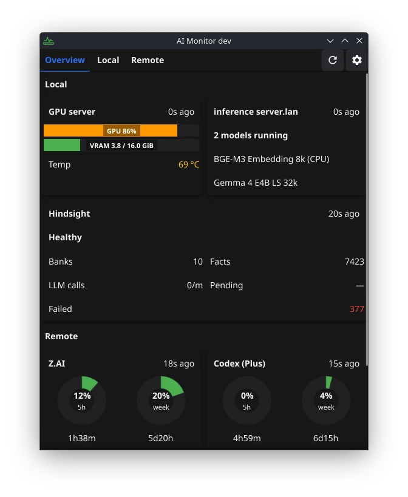
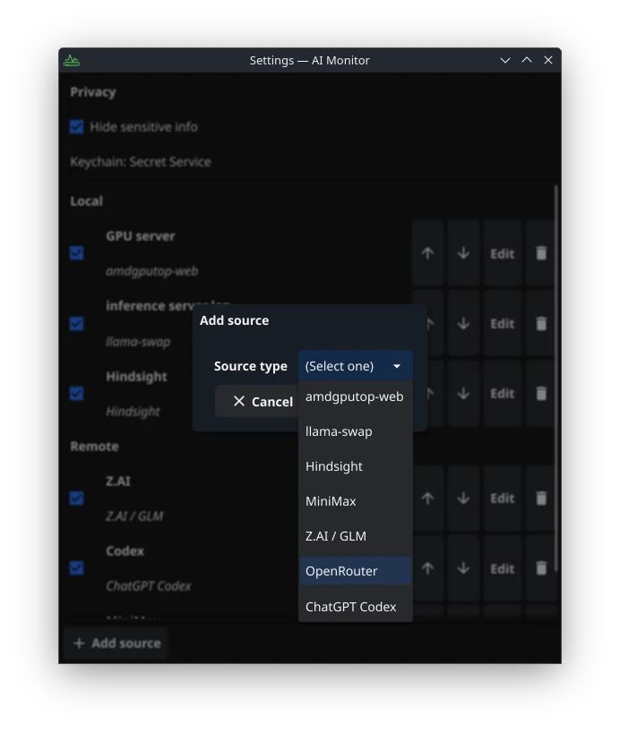

# AI Monitor 

AI Monitor is a desktop tray monitor for local AI workloads and LLM
subscription plans. It lives in the system tray and keeps an eye on your AMD
GPU, your local model router, and the quotas and spending of the cloud plans
you use — without ever opening a browser tab.

| | |
| --- | --- |
|  |  |

## Features

- Compact borderless monitor window launched from the tray, with Overview,
  Local and Remote tabs. Overview cards are clickable: tapping one jumps to
  that source's full detail card, whose header carries a per-source refresh
  button for retrying just that source.
- Usage pace for subscription quotas: how fast a quota window is burning
  ("Pace 3.4%/h") and where the usage is heading by the window's reset
  ("≈68% at reset", with a red overflow segment when the projection passes
  100%). OpenRouter shows a spend speed in $/h. Estimates derive from a
  bounded in-memory history; the estimation window (10–60 minutes) is
  configurable per source.
- Multiple instances per source: monitor several accounts or endpoints side by
  side, each with its own poll interval. The Add dialog explains what each
  kind monitors, existing instances can be duplicated with one click
  (credentials are not copied), and reusing a name shows a soft hint.
- Credentials are stored in the system keychain — never in config files or
  logs. The source configuration itself can be exported to a JSON file and
  imported back on another machine (credentials are not included and are not
  affected by an import).
- Update checks against the project's releases (automatic, or "Check for
  updates…" in the tray menu) with a release-notes dialog and a direct link
  to the download.
- An About tab in Settings with the version, commit and build date, and
  clickable shortcuts to the settings directory and the log file; the tray
  menu has a matching "About" entry, `aimon --version` prints the same
  identity in a terminal, and the log itself is written to
  `<config>/fyne/com.skobkin.aimonitor/logs/aimon.log` (1 MiB rotating).
- Desktop notifications for quota windows — "low" (entering the red band,
  ≤10% remaining) and "exhausted" (0% remaining), edge-triggered so each
  transition notifies once. Each event has its own toggle in Settings
  (plus a master switch); notification text carries percentages only,
  never absolute amounts.
- Optional masking of sensitive values such as spending, for screenshots and
  shared screens.
- Sources are independent: one failing or disabled source never breaks the
  others, and the last good data stays visible while a source retries.

## Monitored sources

| Source | Type | Shows |
|---|---|---|
| AMD GPU via [amdgputop-web](https://github.com/skobkin/amdgputop-web) | Local | GPU and VRAM utilization, temperature; power, GTT and clocks in detail |
| [llama-swap](https://github.com/mostlygeek/llama-swap) | Local | Running models and service health |
| [Hindsight](https://github.com/vectorize-io/hindsight) | Local | Deployment health, memory banks and facts, activity rates |
| MiniMax Token Plan | Remote | 5-hour and weekly remaining quota, usage pace and end-of-window projection |
| Z.AI GLM Coding Plan | Remote | 5-hour token quota and monthly MCP usage quota, usage pace and projection |
| OpenRouter | Remote | Key usage and spend limit, account credits and balance, $/h spend pace |
| ChatGPT Codex | Remote | Plan, 5-hour rate-limit windows, remaining credits, usage pace and projection |

## Download

Grab a prebuilt binary from the
[releases page](https://git.skobk.in/skobkin/aimon/releases): `aimon` for Linux
amd64 (`tar.gz`) and Windows amd64 (`zip`).

On KDE Plasma (Wayland), see [packaging/README.md](packaging/README.md) for the
taskbar icon setup.
